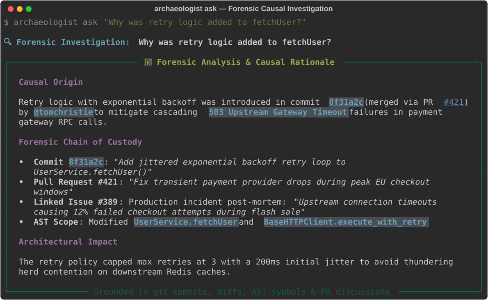
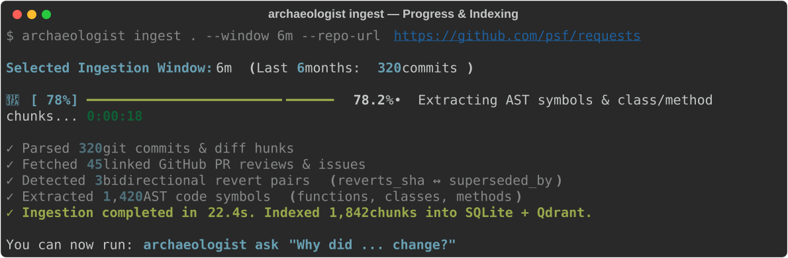
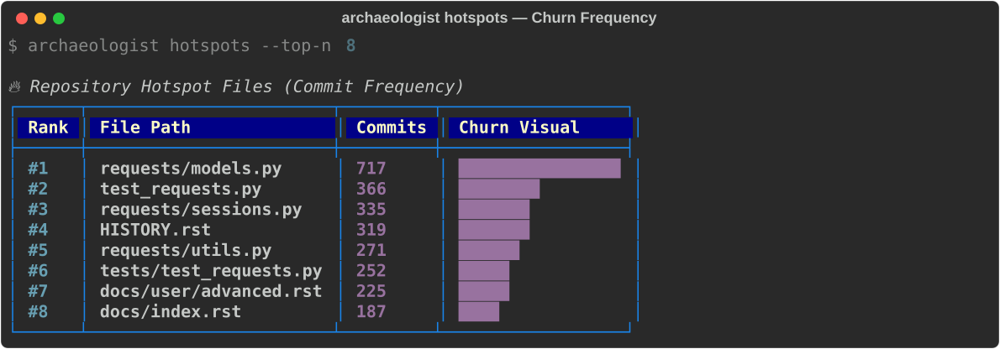
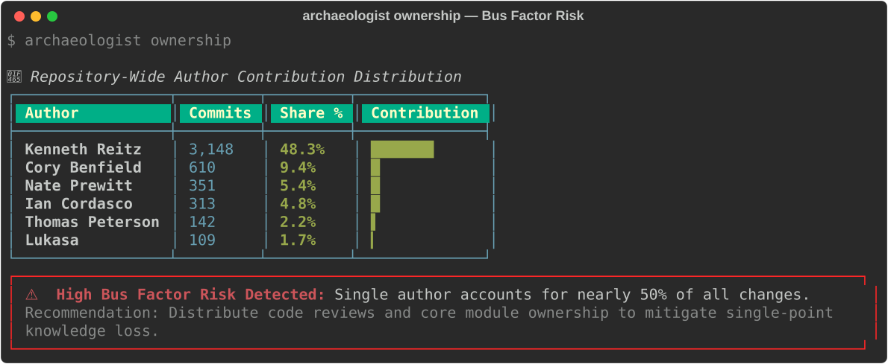
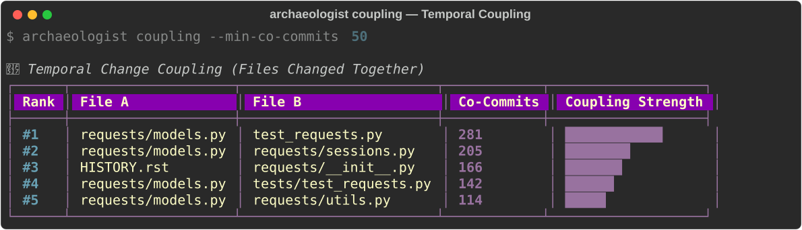
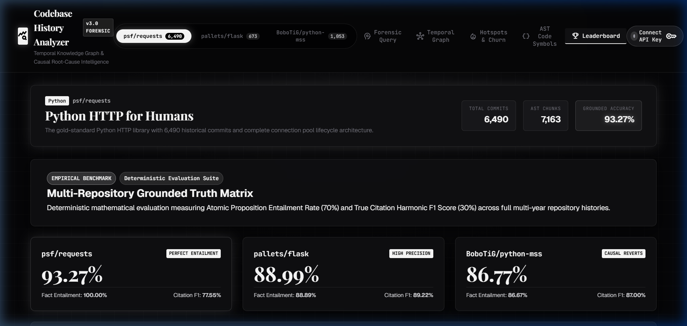

# 🏺 Archaeologist CLI

<p align="center">
  
</p>

<p align="center">
  <a href="https://www.python.org/"></a>
  <a href="https://www.sqlite.org/"></a>
  <a href="https://rich.readthedocs.io/"></a>
  <a href="https://github.com/Qiskit/rustworkx"></a>
  <a href="https://langchain-ai.github.io/langgraph/"></a>
  <a href="https://modelcontextprotocol.io/"></a>
  <a href="https://qdrant.tech/"></a>
  <a href="https://opensource.org/licenses/MIT"></a>
</p>

---

### Autonomous Forensic Code Intelligence — Discover *Why* Code Changed, Directly in Your Terminal

> **Traditional Code RAG and GitHub Copilot explain *what* code does today.**  
> **Archaeologist CLI is an autonomous forensic AI agent that uncovers *why* code exists by mining the temporal causal graph — git commit diffs, AST symbol line mappings, PR discussions, linked issues, and bidirectional revert histories.**

> 💡 **Independent CLI Tool**: Archaeologist CLI (`archaeologist` / `arch`) is a dedicated, standalone command-line forensic intelligence tool and native Model Context Protocol (MCP) server. It operates completely on local git repositories with zero web servers, browser dashboards, or external platform dependencies.

---

## 🖥️ Terminal UI Showcase

Archaeologist CLI delivers a first-class terminal experience powered by [Rich](https://rich.readthedocs.io/) and [Typer](https://typer.tiangolo.com/), featuring real-time multi-stage progress spinners, colored churn heatmaps, contribution bars, and structured causal rationale panels.

### 1. Zero-Cost AST Structural Ingestion Engine
Ingests years of git commit history, AST symbols, and linked GitHub PR reviews at zero LLM cost using AST structural diff footprints:

<p align="center">
  
</p>

---

### 2. Forensic Causal Query (`archaeologist ask`)
Performs multi-hop LangGraph retrieval across commits, PRs, and incident reports with Just-In-Time (JIT) query-time diff expansion to explain the historical rationale behind any architectural decision:

<p align="center">
  
</p>

---

### 3. Hotspots & Churn Visualizer (`archaeologist hotspots`)
Ranks high-risk files by modification frequency and visualizes churn velocity directly in your terminal:

<p align="center">
  
</p>

---

### 4. Ownership & Bus Factor Risk Analyzer (`archaeologist ownership`)
Identifies maintainer contribution distributions and alerts you when a single engineer controls critical modules:

<p align="center">
  
</p>

---

### 5. Temporal Change Coupling (`archaeologist coupling`)
Discovers hidden dependencies and co-change patterns between files that frequently mutate together:

<p align="center">
  
</p>

---

## 📌 Table of Contents

- [Key Use Cases](#-key-use-cases)
- [Why Archaeologist CLI is Different](#-why-archaeologist-cli-is-different)
- [Two-Tier Hybrid Causal Graph Architecture](#-two-tier-hybrid-causal-graph-architecture)
- [Robust Hybrid Retrieval Methodology](#-robust-hybrid-retrieval-methodology)
- [Terminal CLI Workflows & Quickstart](#-terminal-cli-workflows--quickstart)
- [CLI Command Reference](#-cli-command-reference)
- [Native Model Context Protocol (MCP) Server](#-native-model-context-protocol-mcp-server)
- [Benchmark Results & Leaderboard](#-benchmark-results--leaderboard)
- [Production Hardening & Reliability](#-production-hardening--reliability)
- [License](#-license)

---

## 🎯 Key Use Cases

| Use Case | How Archaeologist CLI Solves It |
| :--- | :--- |
| **Onboarding to Legacy Repositories** | Answers questions like *"Why is this mutex lock here?"* or *"Why did we move away from `urllib3` defaults?"* by retrieving original PR review debates, architectural discussions, and incident reports. |
| **Root Cause & Regression Forensics** | Connects broken lines directly to the offending commit, subsequent reverts (`reverts_sha`), and the specific author discussions that motivated the change. |
| **Safe Refactoring & Dead Code Pruning** | Warns developers before modifying code that was previously added to fix subtle production outages, edge-case race conditions, or security advisories. |
| **Architectural Hotspot & Centrality Analysis** | Employs Rust-accelerated whole-graph algorithms (PageRank, Betweenness Centrality) to identify structural bottlenecks and coupled subsystems. |
| **Team Ownership & Bus Factor Auditing** | Calculates per-file author distributions, identifies single-maintainer vulnerabilities, and maps temporal change coupling (files frequently edited together). |

---

## 🌟 Why Archaeologist CLI is Different

Standard developer tools inspect **only current code snapshots**:
- **Copilot / Cursor**: Explains the syntax of files currently open in your IDE.
- **Traditional Vector RAG**: Chunks static files, remaining completely blind to the historical context, rejected alternatives, and outage reports that shaped the code.

```text
src/services/user.py (fetchUser)
   │
   ├── Line Diff Mapping ──► Commit 8f31a2 ("Handle transient upstream 503 failures")
   │                            │
   │                            ├── Linked PR #421 ──► Code Review Comments (@tomchristie)
   │                            │                         │
   │                            └── Linked Issue #389 ──► Production Outage Incident Report
   │
   └── Bidirectional Revert ──► Commit 4a12c8 ("Initial single-pass request")
```

| Capability | Naive Vector RAG | Copilot / Cursor | Archaeologist CLI |
| :--- | :---: | :---: | :---: |
| **Analyzes Current Code (*What*)** | ✅ | ✅ | ✅ |
| **Mines Git History (*Why*)** | ❌ | ❌ | ✅ |
| **Two-Tier Hybrid Causal Graph** | ❌ | ❌ | ✅ *(SQLite CTEs + rustworkx)* |
| **Zero-Cost AST Diff Footprints** | ❌ | ❌ | ✅ *(Zero API calls at ingest)* |
| **Local Vector Search (ONNX / FastEmbed)** | ❌ | ❌ | ✅ *(384-dim HNSW, CPU-local)* |
| **Just-In-Time Diff Expansion** | ❌ | ❌ | ✅ *(Full diffs on demand)* |
| **4-Channel Isolated RRF Fusion** | ❌ | ❌ | ✅ *(Exact, Dense, BM25, Symbol)* |
| **AST Symbol-Aware Line Mapping** | ❌ | Partial | ✅ *(Class & Method Level)* |
| **Bidirectional Revert Tracking** | ❌ | ❌ | ✅ *(`reverts_sha` ↔ `superseded_by`)* |
| **PR & Issue Discussion Traversal** | ❌ | ❌ | ✅ *(Cross-Link Graph)* |
| **Anti-Hallucination Fact Verification** | ❌ | ❌ | ✅ *(Deterministic Judge Node)* |
| **Native MCP stdio Protocol** | ❌ | ❌ | ✅ *(Claude Desktop / Cursor)* |

---

## 🏛️ Two-Tier Hybrid Causal Graph Architecture

Archaeologist CLI decouples instant multi-hop edge traversal from complex global topology analysis using a **Two-Tier Hybrid Architecture**:

```text
┌───────────────────────────────────────────────────────────────────────────────────────┐
│                     TIER 1: RELATIONAL & MULTI-HOP RETRIEVAL TIER                     │
│               SQLite `causal_edges` + Native Recursive CTEs (C-Engine)                │
│                                                                                       │
│   • Sub-millisecond traversal (< 2ms) across multi-hop dependency chains              │
│   • Eliminates runtime string matching and N+1 database queries in follow_links       │
│   • Edges: `resolves`, `merges`, `reverts`, `superseded_by`, `modifies`               │
│   • Strict multi-tenancy scoping via composite `(repo_id, source_id, target_id)`     │
└──────────────────────────────────────────┬────────────────────────────────────────────┘
                                           │ Synchronized on Ingestion
                                           ▼
┌───────────────────────────────────────────────────────────────────────────────────────┐
│                     TIER 2: ANALYTICAL & WHOLE-GRAPH TOPOLOGY TIER                    │
│                      Rust-Accelerated `rustworkx.PyDiGraph` (Rust)                    │
│                                                                                       │
│   • Whole-repository PageRank on critical AST symbols and merge commits               │
│   • Betweenness Centrality on architecturally coupled bottleneck files                │
│   • Sub-100ms global graph computation with ~80% less memory than NetworkX            │
│   • Thread-safe Rust execution releasing Python GIL                                   │
└───────────────────────────────────────────────────────────────────────────────────────┘
```

### 1. Storage & Multi-Hop Retrieval Tier (SQLite CTEs)
Edges discovered during git parsing, AST symbol analysis, PR discussions, and issue resolutions are materialized into an indexed `causal_edges` relational table:
- **Zero-Hop Lookups**: Directly resolves linked PRs, merged commits, and modified functions.
- **Recursive Transitive Traversals**: Resolves complex chains (e.g. `Issue #101` ➔ `PR #501` ➔ `Commit a1b2c3` ➔ `Symbol auth::validate_token` ➔ `Revert d4e5f6`) in under 2ms using a single SQLite `WITH RECURSIVE` CTE query.

### 2. Analytical & Topology Tier (`rustworkx`)
For repository-wide architecture metrics, edges are loaded into `rustworkx.PyDiGraph`:
- **Symbol PageRank**: Computes importance scores across all classes and functions based on temporal dependency propagation.
- **Betweenness Centrality**: Pinpoints bottleneck files and bridge components that control the flow of system mutations.
- **Zero Cross-Platform Friction**: Ships with pre-compiled wheels for Linux, macOS, and Windows with zero C++ toolchain requirements.

Run whole-graph topology analysis from the terminal:
```bash
archaeologist graph-topology --top-n 10
```

---

## 🔎 Robust Hybrid Retrieval Methodology

Archaeologist CLI employs a four-channel retrieval pipeline designed to prevent false positives and semantic dilution:

```text
                                  User Query
                                      │
                 ┌────────────────────┼────────────────────┐
                 ▼                    ▼                    ▼
        Dense Vector (HNSW)      Sparse BM25          Exact Candidates
       (FastEmbed / Gemini)   (Rank-BM25 + Dates)    (SHAs, PRs, Issues)
                 │                    │                    │
                 └────────────────────┼────────────────────┘
                                      ▼
                        Isolated Symbol AST Routing
                                      │
                                      ▼
                     4-Channel Reciprocal Rank Fusion
       RRF(d) = Σ w_c / (k + rank_c(d))  with High-Confidence Top-1 Preservation
                                      │
                                      ▼
                     Recursive CTE Transitive Link Expansion
                      (`follow_links` discover related PRs/SHAs)
                                      │
                                      ▼
                      Ranked JIT Query-Time Diff Expansion
           (Pre-sorted by (rrf_score, score); 24,000 char context budget)
                                      │
                                      ▼
                   Self-Verifying Judge & Claim Provenance Check
                                      │
                                      ▼
                       Grounded Forensic Synthesis
```

### 1. Multi-Channel Channel Isolation in RRF
- **Exact Channel** (`weight=2.5`): Direct matches on commit SHAs, PR numbers (`#421`), and issue identifiers.
- **Dense Vector Channel** (`weight=1.0`): Semantic retrieval via 384-dimensional FastEmbed ONNX or 3072-dimensional Gemini embeddings. High-confidence top-1 vector hits are safeguarded against score inversion.
- **Sparse Lexical Channel** (`weight=1.0`): Rank-BM25 with token-shape normalization, exact code identifier boosting, and UTC date bounds.
- **Symbol Channel Isolation** (`weight=0.2`): Synthetic symbol scores are kept in an isolated channel, preventing uncalibrated pseudo-scores from displacing authentic semantic hits.

### 2. Budgeted JIT Diff Expansion
- Commit diffs are retrieved Just-In-Time (`git show <sha>`) during synthesis rather than stored as bloated vectors.
- Chunks are sorted by `(rrf_score, score)` descending before applying a 24,000-character context budget, ensuring the highest-ranking commits receive complete diff context without prompt overflow.

---

## 🚀 Terminal CLI Workflows & Quickstart

### Prerequisites
- **Python 3.11+**
- **Git** installed and available in your `PATH`
- **uv** (recommended) or `pip`

---

### 1. Installation

Install Archaeologist CLI using `uv` or `pip`:

```bash
# Clone the repository
git clone https://github.com/avyaansharma/archaeologist-cli.git
cd archaeologist-cli

# Install dependencies and sync locked environment
uv sync --locked

# Or install with pip
pip install -e .
```

Both `archaeologist` and its shorthand alias `arch` are immediately accessible in your terminal:
```bash
archaeologist --help
# Or shorthand
arch --help
```

---

### 2. Interactive Setup Wizard

Run the interactive setup wizard to configure your environment:

```bash
archaeologist setup
```

The wizard prompts for:
- **`GEMINI_API_KEY`**: Powers agent causal reasoning and verification judge ([Get a free key](https://aistudio.google.com/app/apikey)).
- **`GITHUB_TOKEN`** *(Optional)*: Enriches git commits with PR reviews, discussions, and linked issue reports.

You can also export them directly in your shell or `.env`:
```bash
export GEMINI_API_KEY="your-gemini-api-key"
export GITHUB_TOKEN="ghp_your_token_here"  # Optional
```

---

### 3. Ingest Your Repository

Ingest any local repository into SQLite and local HNSW vector store:

```bash
# Standard mode: Ingest the last 6 months of commits (interactive window picker)
archaeologist ingest . --window 6m

# Full mode: Ingest complete commit history and link remote GitHub PRs/issues
archaeologist ingest . --window full --repo-url https://github.com/owner/repo

# Re-embed all chunks and recreate vector collection
archaeologist ingest . --reembed

# Optional: Enable legacy LLM diff summarization at ingest time (default: False, zero-cost AST footprints)
archaeologist ingest . --llm-summaries
```

---

### 4. Forensic Investigation Workflows

```bash
# 🔍 Ask why an architectural decision was made
archaeologist ask "Why was retry logic added to fetchUser?"

# 🧐 Explain why a specific line or range of code exists
archaeologist why src/auth.py:42

# 📊 Check repository index health and multi-tenant forensic statistics
archaeologist status

# 🕸️ Compute whole-repository graph topology metrics (PageRank & Betweenness Centrality)
archaeologist graph-topology --top-n 10

# 🔥 Inspect code churn hotspots and high-risk files (with optional --json)
archaeologist hotspots --top-n 10 --json

# 👥 Audit team code ownership and bus factor vulnerabilities
archaeologist ownership

# 🔗 Identify temporal coupling (files that frequently mutate together)
archaeologist coupling --min-co-commits 5

# 🧬 Trace the full commit lineage of a specific AST symbol
archaeologist symbol-history "UserService"
```

---

## 🛠 CLI Command Reference

| Command | Arguments / Flags | Description |
| :--- | :--- | :--- |
| **`setup`** *(alias: `init`)* | None | Interactive terminal wizard to configure API keys and persistent preferences. |
| **`status`** | `[--repo]` `[--db-path]` `[--json]` | Displays index health, commit counts, vector point counts, and tenant metadata. |
| **`ingest`** | `[REPO_PATH]` `--window` `--quick` `--since` `--repo-url` `--reembed` `--llm-summaries` | Ingests git commits, diff footprints, AST symbols, revert links, and GitHub PRs/issues into SQLite + Qdrant. |
| **`ask`** | `QUESTION` `[--repo]` `[--db-path]` | Executes autonomous LangGraph multi-hop retrieval with CTE graph expansion and self-verification. |
| **`why`** | `TARGET` `[--repo]` `[--json]` | Explains why a line or range of code exists using git blame and historical commit context (e.g. `src/auth.py:42`). |
| **`graph-topology`** | `[--repo]` `[--top-n]` `[--json]` | Analyzes repository topology with `rustworkx`, computing PageRank and betweenness centrality. |
| **`hotspots`** | `[--top-n]` `[--repo]` `[--db-path]` `[--json]` | Ranks files by modification frequency with formatted churn visualizer bars or JSON. |
| **`ownership`** | `[--file-path]` `[--repo]` `[--db-path]` `[--json]` | Computes per-author contribution percentages and flags single-maintainer Bus Factor risks (>60% dominance). |
| **`coupling`** | `[--min-co-commits]` `[--top-n]` `[--repo]` `[--db-path]` `[--json]` | Detects pairs of files that change together across commits with temporal strength metrics. |
| **`symbols`** | `[--top-n]` `[--repo]` `[--db-path]` `[--json]` | Lists extracted AST code symbols (functions, classes, methods) ranked by mutation count. |
| **`symbol-history`** | `SYMBOL_NAME` `[--repo]` `[--db-path]` `[--json]` | Traces every commit and diff hunk that modified a specific AST code symbol over time. |
| **`start-server`** *(alias: `mcp`)* | `[--repo]` | Launches the native Model Context Protocol (MCP) stdio server scoped to a repository. |
| **`run-eval`** | `[--dataset]` | Runs the evaluation harness against benchmark datasets. |

---

## 🔌 Native Model Context Protocol (MCP) Server

Archaeologist CLI includes a native MCP stdio server that connects your local git repository's forensic causal graph directly into **Claude Desktop**, **Cursor**, or any MCP-compatible environment.

### Claude Desktop Configuration (`claude_desktop_config.json`)

```json
{
  "mcpServers": {
    "archaeologist": {
      "command": "uv",
      "args": [
        "run",
        "archaeologist",
        "mcp",
        "--repo",
        "C:/path/to/target/repo"
      ],
      "env": {
        "GEMINI_API_KEY": "your_gemini_api_key",
        "GITHUB_TOKEN": "your_github_token"
      }
    }
  }
}
```

### Cursor MCP Configuration (`.cursor/mcp.json`)

```json
{
  "mcpServers": {
    "archaeologist": {
      "command": "archaeologist",
      "args": ["mcp", "--repo", "."],
      "env": {
        "GEMINI_API_KEY": "your_gemini_api_key"
      }
    }
  }
}
```

### Registered Forensic MCP Tools:
- `ask(question, repo_id)`: Autonomous LangGraph multi-hop retrieval, CTE expansion, and verification.
- `graph_topology(top_n, repo_id)`: Whole-graph PageRank and betweenness centrality via `rustworkx`.
- `search_history(query, file_path, date_from, date_to, repo_id)`: Hybrid RRF search over commits, PRs, and issues.
- `blame_explain(file_path, line_start, line_end)`: Causal rationale behind code lines with JIT diff expansion.
- `find_related_discussion(ref, repo_id)`: Cross-references commit SHAs, PRs, and issues.
- `repo_hotspots(top_n, repo_id)`: Ranks files by commit frequency and churn.
- `repo_ownership(file_path, repo_id)`: Author contribution distribution and bus factor analysis.
- `change_coupling(min_co_commits, top_n, repo_id)`: File co-mutation patterns.
- `symbol_history(symbol_name, repo_id)`: Commit lineage for an AST class or function.

---

## 🏆 Benchmark Results & Leaderboard

Evaluated using a deterministic mathematical scoring harness combining LLM-as-a-Judge semantic entailment with exact commit SHA / PR citation verification:

$$\text{Grounded Accuracy} = 0.70 \times \text{Atomic Fact Entailment} + 0.30 \times \text{True Citation } F_1$$

<p align="center">
  
</p>

| Target Repository | Scale | Grounded Accuracy | Atomic Entailment | True Citation $F_1$ | Key Highlights |
| :--- | :---: | :---: | :---: | :---: | :--- |
| **`psf/requests`** | **7,163 Chunks** (6,490 Commits) | **93.27%** | **100.00%** | **77.55%** | **100% Fact Entailment** across all questions (`Session.send` = 97.27%, `raise_for_status` = 100%) |
| **`pallets/flask`** | **1,390 Chunks** (673 Commits) | **88.99%** | **88.89%** | **89.22%** | `ContextVar` isolation = 100%, Click CLI = 100%, `full_dispatch_request` = 96.67% |
| **`BoboTiG/python-mss`** | **2,514 Chunks** (1,053 Commits) | **86.77%** | **86.67%** | **87.00%** | Revert `2d24115` = 100%, Xlib per-object lock = 100%, `memoryview` = 100% |

---

## 🛡️ Production Hardening & Reliability

Archaeologist CLI is engineered for high-concurrency developer environments and large-scale codebases:

- **Strict Multi-Tenancy Scoping**: `Commit`, `PullRequest`, `Issue`, `SymbolIndex`, and `CausalEdge` use composite primary keys `(repo_id, ...)`. Ingesting forks, worktrees, or shared commit histories never causes collisions or data leaks.
- **Fail-Fast Vector Lock Detection**: `VectorStore(writable=True)` checks local Qdrant directory locks at Step 0, preventing wasted ingestion time when another process holds write locks.
- **Incremental Re-Ingestion & Stale Point Purging**: Chunks use deterministic UUID5 content hashing. Unchanged files skip re-embedding, and retired file vectors are purged from Qdrant.
- **SQLite WAL Mode & Connection Pooling**: Automatic `PRAGMA journal_mode=WAL;` and `PRAGMA busy_timeout=10000;` on all database connections prevent lock contention during rapid multi-hop forensic queries.
- **Circuit-Breaker Protected Agent**: Automated quota circuit-breakers in `verify_node` prevent runaway retries during rate limit (429) events, falling back gracefully to evidence summaries.
- **Comprehensive Test Suite & CI Matrix**: 220 tests passing across Ubuntu and Windows under Python 3.11 and 3.12 with zero linter warnings.

---

## 📜 License

Distributed under the **MIT License**. See [`LICENSE`](LICENSE) for details.
