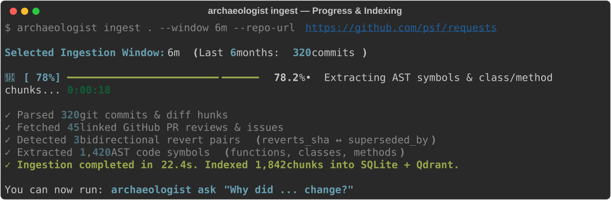
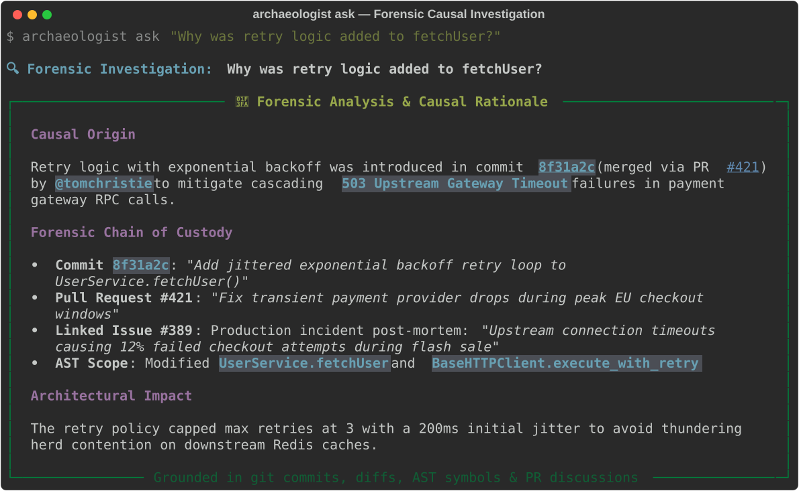
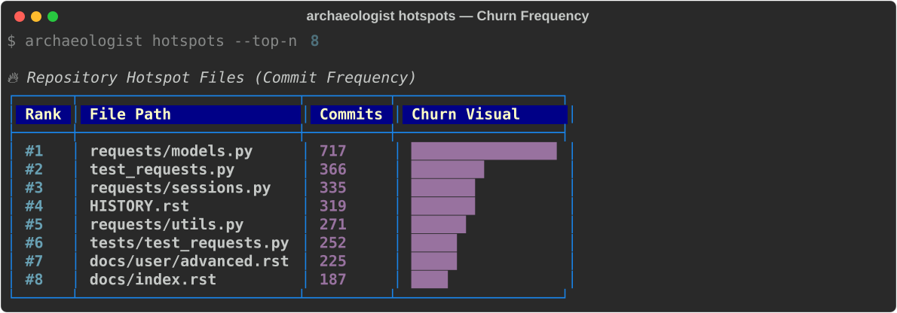
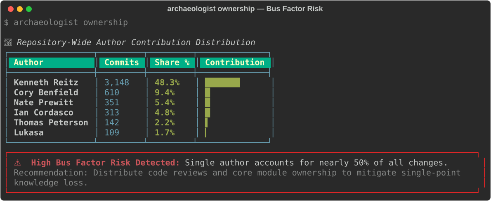
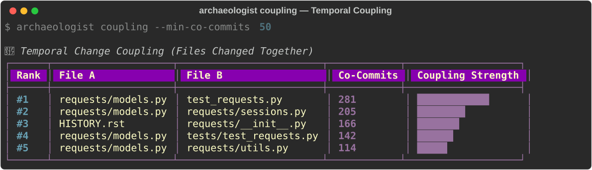
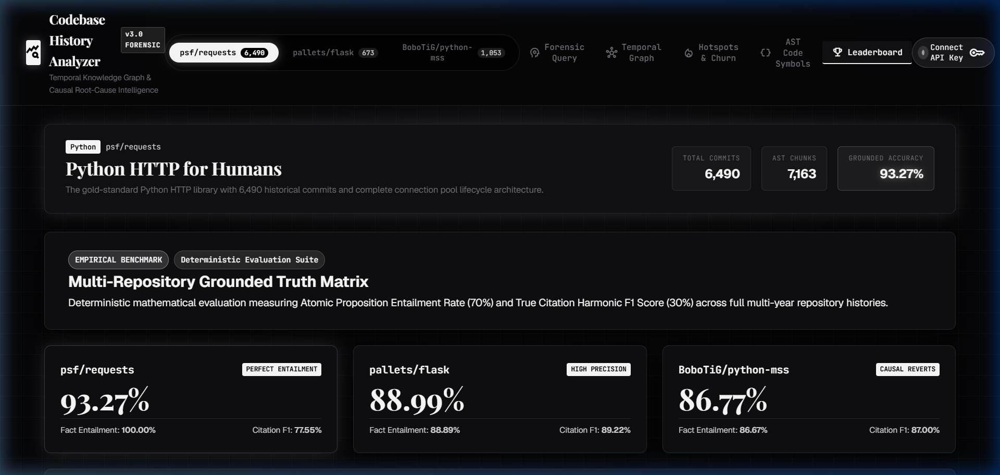

# 🏺 Archaeologist CLI

**Ask your git history why the code is the way it is.**

<p align="center">
  <video src="docs/images/archaeologist_demo.mp4" width="100%" controls autoplay loop muted></video>
</p>

<p align="center">
  <a href="https://www.python.org/"></a>
  <a href="https://github.com/avyaansharma/archaeologist-cli/actions/workflows/ci.yml"></a>
  <a href="https://modelcontextprotocol.io/"></a>
  <a href="https://opensource.org/licenses/MIT"></a>
</p>

Code assistants and code RAG explain what your code does today. Archaeologist CLI explains why it got that way. It indexes a repository's commits, diffs, AST symbols and reverts into a local graph, adds GitHub PR and issue discussions if you give it a token, and answers questions with citations to the exact commits and PRs.

A typical case: you are about to make a change that someone already made two years ago and reverted a week later. Archaeologist finds the original commit, the revert, and the discussion that explains why.

It runs as a terminal tool (`archaeologist`, or `arch` for short) and as an MCP server for Claude Desktop, Cursor and other MCP clients.

**Built with:** Typer + Rich, SQLite, rustworkx, LangGraph, Qdrant, FastEmbed.

## Contents

- [Quickstart](#quickstart)
- [Commands](#commands)
- [Screenshots](#screenshots)
- [What it is for](#what-it-is-for)
- [How it differs from code RAG and IDE assistants](#how-it-differs-from-code-rag-and-ide-assistants)
- [How it works](#how-it-works)
- [MCP server](#mcp-server)
- [Benchmarks](#benchmarks)
- [Privacy and cost](#privacy-and-cost)
- [Reliability](#reliability)
- [License](#license)

## Quickstart

**Requirements:** Python 3.11+, Git, and `uv` (recommended) or `pip`.

### 1. Install

```bash
git clone https://github.com/avyaansharma/archaeologist-cli.git
cd archaeologist-cli

uv sync --locked
# or: pip install -e .
```

This installs the `archaeologist` command and its short alias `arch`. If you installed with `uv`, activate the environment first (`source .venv/bin/activate`, or `.venv\Scripts\activate` on Windows) or prefix commands with `uv run`.

### 2. Configure a model

**Option A: Google Gemini (default)**

```bash
archaeologist setup
```

The wizard asks for:

- **`GEMINI_API_KEY`**: powers the agent's reasoning and the verification judge. [Get a free key](https://aistudio.google.com/app/apikey).
- **`GITHUB_TOKEN`** (optional): adds PR reviews, discussions and linked issues to the index.

You can also set both as environment variables or in a `.env` file.

**Option B: fully local (Ollama, vLLM, LM Studio)**

```bash
export LOCAL_LLM_URL="http://localhost:11434/v1"   # any OpenAI-compatible endpoint
export LOCAL_LLM_MODEL="qwen2.5-coder:7b"          # or llama3.2, deepseek-coder
export USE_FASTEMBED=true                          # local CPU embeddings
```

With this setup nothing leaves your machine.

### 3. Ingest a repository

```bash
# Last 6 months of commits
archaeologist ingest . --window 6m

# Full history, with GitHub PRs and issues linked
archaeologist ingest . --window full --repo-url https://github.com/owner/repo

# Re-embed all chunks and recreate the vector collection
archaeologist ingest . --reembed

# Opt in to LLM diff summaries at ingest time (off by default)
archaeologist ingest . --llm-summaries
```

### 4. Investigate

```bash
# Why was a decision made?
archaeologist ask "Why was retry logic added to fetchUser?"

# Why does this line exist?
archaeologist why src/auth.py:42

# Is the index healthy?
archaeologist status

# Which symbols and files are structurally most important?
archaeologist graph-topology --top-n 10

# Which files change the most?
archaeologist hotspots --top-n 10

# Who owns the code, and where is the bus factor risk?
archaeologist ownership

# Which files tend to change together?
archaeologist coupling --min-co-commits 5

# Every commit that touched a class or function
archaeologist symbol-history "UserService"
```

Most commands accept `--json` for machine-readable output.

## Commands

| Command | Arguments / flags | What it does |
| :--- | :--- | :--- |
| `setup` (alias `init`) | | Interactive wizard for API keys and preferences. |
| `status` | `--repo` `--db-path` `--json` | Index health, commit counts, vector point counts and repository metadata. |
| `ingest` | `[REPO_PATH]` `--window` `--quick` `--since` `--repo-url` `--reembed` `--llm-summaries` | Ingests commits, diff footprints, AST symbols, revert links and GitHub PRs/issues into SQLite and Qdrant. |
| `ask` | `QUESTION` `--repo` `--db-path` | Multi-hop retrieval with graph expansion and verification. Returns a cited answer. |
| `why` | `TARGET` `--repo` `--json` | Explains why a line or range exists, using git blame and commit context (for example `src/auth.py:42`). |
| `graph-topology` | `--repo` `--top-n` `--json` | PageRank and betweenness centrality over the repository graph. |
| `hotspots` | `--top-n` `--repo` `--db-path` `--json` | Ranks files by how often they change. |
| `ownership` | `--file-path` `--repo` `--db-path` `--json` | Per-author contribution share. Flags a single author above 60%. |
| `coupling` | `--min-co-commits` `--top-n` `--repo` `--db-path` `--json` | Finds file pairs that change in the same commits. |
| `symbols` | `--top-n` `--repo` `--db-path` `--json` | Lists functions, classes and methods by number of modifications. |
| `symbol-history` | `SYMBOL_NAME` `--repo` `--db-path` `--json` | Every commit and diff hunk that modified a symbol. |
| `start-server` (alias `mcp`) | `--repo` | Starts the MCP stdio server, scoped to one repository. |
| `run-eval` | `--dataset` | Runs the evaluation harness against the benchmark datasets. |

## Screenshots

<details>
<summary>Ingestion (<code>archaeologist ingest</code>)</summary>


</details>

<details>
<summary>Causal query (<code>archaeologist ask</code>)</summary>


</details>

<details>
<summary>Hotspots and churn (<code>archaeologist hotspots</code>)</summary>


</details>

<details>
<summary>Ownership and bus factor (<code>archaeologist ownership</code>)</summary>


</details>

<details>
<summary>Change coupling (<code>archaeologist coupling</code>)</summary>


</details>

## What it is for

- **Joining an old codebase.** Ask "Why is this mutex lock here?" or "Why did we move away from `urllib3` defaults?" and get the original PR debate and incident report.
- **Tracking down a regression.** Go from a broken line to the commit that introduced it, any later reverts, and the discussion that motivated the change.
- **Refactoring safely.** Find out whether the code you want to delete was added to fix an outage, a race condition or a security advisory.
- **Finding structural bottlenecks.** PageRank and betweenness centrality show which symbols and files the rest of the codebase depends on.
- **Auditing ownership.** Per-file author distribution, single-maintainer warnings, and files that are usually edited together.

## How it differs from code RAG and IDE assistants

An IDE assistant can read `git log` when you ask, but it starts from zero every time and only sees what fits in its context window. Plain code RAG chunks the current files and knows nothing about the alternatives that were rejected or the outages that shaped them.

Archaeologist ingests the history once and keeps it as a graph, so every question searches all of it:

```text
src/services/user.py (fetchUser)
   │
   ├── Line Diff Mapping ──► Commit 8f31a2 ("Handle transient upstream 503 failures")
   │                            │
   │                            ├── Linked PR #421 ──► Code review comments
   │                            │
   │                            └── Linked Issue #389 ──► Production outage report
   │
   └── Bidirectional Revert ──► Commit 4a12c8 ("Initial single-pass request")
```

| | Code RAG over current files | Archaeologist CLI |
| :--- | :---: | :---: |
| Explains what the code does | ✅ | ✅ |
| Indexes commit history and diffs | ❌ | ✅ |
| Follows links between commits, PRs and issues | ❌ | ✅ |
| Tracks reverts in both directions (`reverts_sha` ↔ `superseded_by`) | ❌ | ✅ |
| History per class, function or method | ❌ | ✅ |
| Checks citations against the repository before answering | ❌ | ✅ |
| Whole-repository graph metrics | ❌ | ✅ |

## How it works

### 1. Ingestion

Git history, AST symbols, reverts and (with a token) GitHub PRs and issues are parsed into SQLite. Diffs are stored as AST structural footprints instead of LLM summaries, so ingestion makes no LLM calls unless you pass `--llm-summaries`. Chunks are embedded and stored in an embedded Qdrant collection.

Re-ingestion is incremental. Chunks are keyed by a content hash, unchanged files skip re-embedding, and vectors for deleted files are purged.

### 2. Two-tier causal graph

Fast link traversal and whole-graph analysis have different needs, so they run on different engines:

```text
TIER 1  Relational, multi-hop retrieval
        SQLite `causal_edges` table + recursive CTEs
        • Multi-hop traversal in under 2 ms
        • No runtime string matching or N+1 queries in follow_links
        • Edge types: resolves, merges, reverts, superseded_by, modifies
        • Scoped per repository by (repo_id, source_id, target_id)
            │
            │  synchronized on ingestion
            ▼
TIER 2  Analytical, whole-graph topology
        rustworkx.PyDiGraph (Rust)
        • PageRank over AST symbols and merge commits
        • Betweenness centrality to find bottleneck files
        • Runs in Rust with the Python GIL released
```

**Tier 1** stores every edge found during git parsing, symbol analysis, PR discussions and issue resolutions. A chain such as `Issue #101` → `PR #501` → `Commit a1b2c3` → `Symbol auth::validate_token` → `Revert d4e5f6` resolves in a single `WITH RECURSIVE` query.

**Tier 2** loads the same edges into `rustworkx` for repository-wide metrics. `rustworkx` ships pre-compiled wheels for Linux, macOS and Windows, so no C++ toolchain is needed.

```bash
archaeologist graph-topology --top-n 10
```

### 3. Retrieval

A question is searched through four channels, which are merged with weighted Reciprocal Rank Fusion, `RRF(d) = Σ w_c / (k + rank_c(d))`:

| Channel | Weight | What it matches |
| :--- | :---: | :--- |
| Exact | 2.5 | Commit SHAs, PR numbers (`#421`) and issue identifiers. |
| Dense vector | 1.0 | Meaning. 768-dim `jinaai/jina-embeddings-v2-base-code` via FastEmbed ONNX, 384-dim BGE, or 3072-dim Gemini embeddings. |
| Sparse BM25 | 1.0 | Keywords, with code identifier boosting and date bounds. |
| Symbol | 0.2 | AST symbol names. Kept in its own channel so synthetic scores cannot displace real semantic hits. |

Two more steps shape what reaches the model:

- **Link expansion.** `follow_links` walks `resolves`, `merges`, `reverts` and `superseded_by` edges from each hit. Discovered nodes inherit a decayed score, `max(0.012, parent_score × 0.92^depth)`, so a PR discussion ranks next to the commit it explains.
- **Sub-question budgeting.** A complex question is split into sub-questions. The top 3 chunks from each are interleaved before the rest are filled in, so one sub-question cannot crowd out the others.

### 4. Verification

A second LLM call that fact-checks the first is slow and tends to agree with it. Archaeologist instead checks the draft against the repository's own records (`verification_engine.py`), and calls the LLM judge only when those checks neither confirm nor contradict it.

1. **Link hydration.** Before drafting, missing linked PRs, issues and reverted commits are pulled from SQLite for the top chunks.
2. **Relational checks.** Every cited SHA and PR must exist. Each commit must actually touch the file and symbol the draft attributes to it, which catches answers stitched together from different commits. Revert direction and commit chronology are checked too.
3. **Identifier grounding.** Code identifiers in the draft must appear in the evidence. A contradiction in stage 2 or 3 fails the draft immediately, and a fully verified draft passes immediately. Neither path uses judge tokens.
4. **Final guardrail.** After full diffs are expanded on demand (`git show <sha>`, 24,000-character budget) and the answer is written, it is scanned for references that were not in the evidence, and any verified PR or issue links it left out are appended.

## MCP server

The MCP stdio server exposes the same index to Claude Desktop, Cursor or any MCP client.

**Claude Desktop** (`claude_desktop_config.json`):

```json
{
  "mcpServers": {
    "archaeologist": {
      "command": "uv",
      "args": [
        "--directory",
        "/path/to/archaeologist-cli",
        "run",
        "archaeologist",
        "mcp",
        "--repo",
        "/path/to/target/repo"
      ],
      "env": {
        "GEMINI_API_KEY": "your_gemini_api_key",
        "GITHUB_TOKEN": "your_github_token"
      }
    }
  }
}
```

**Cursor** (`.cursor/mcp.json`). This assumes `archaeologist` is on your `PATH`:

```json
{
  "mcpServers": {
    "archaeologist": {
      "command": "archaeologist",
      "args": ["mcp", "--repo", "."],
      "env": {
        "GEMINI_API_KEY": "your_gemini_api_key"
      }
    }
  }
}
```

**Tools:**

- `ask(question, repo_id)`: multi-hop retrieval, graph expansion and verification.
- `graph_topology(top_n, repo_id)`: PageRank and betweenness centrality.
- `search_history(query, file_path, date_from, date_to, repo_id)`: hybrid search over commits, PRs and issues.
- `blame_explain(file_path, line_start, line_end)`: why specific lines exist.
- `find_related_discussion(ref, repo_id)`: commits, PRs and issues linked to a reference.
- `repo_hotspots(top_n, repo_id)`: files ranked by commit frequency.
- `repo_ownership(file_path, repo_id)`: author distribution and bus factor.
- `change_coupling(min_co_commits, top_n, repo_id)`: files that change together.
- `symbol_history(symbol_name, repo_id)`: commit lineage of a class or function.

## Benchmarks

### Answer quality

Each answer gets two scores. Citations are checked exactly: the cited SHA must exist in the git object tree and the PR must resolve in SQLite. Facts are checked by an LLM judge at temperature 0, which decides whether each ground-truth statement is supported by the answer.

$$\text{Grounded Accuracy} = 0.70 \times \text{Atomic Fact Entailment} + 0.30 \times \text{True Citation } F_1$$

| Repository | Size | Grounded accuracy | Fact entailment | Citation F1 |
| :--- | :--- | :---: | :---: | :---: |
| `psf/requests` | 6,490 commits, 7,163 chunks | **93.27%** | 100.00% | 77.55% |
| `pallets/flask` | 673 commits, 1,390 chunks | **88.99%** | 88.89% | 89.22% |
| `BoboTiG/python-mss` | 1,053 commits, 2,514 chunks | **86.77%** | 86.67% | 87.00% |

<p align="center">
  
</p>

### Against simpler approaches

| Approach | Grounded accuracy | Fact entailment | Citation F1 |
| :--- | :---: | :---: | :---: |
| BM25 keyword search | 38.5% | 46.2% | 20.5% |
| Vector RAG over chunks | 44.2% | 51.0% | 28.3% |
| Git blame + log keyword search | 51.3% | 58.7% | 34.0% |
| **Archaeologist CLI** (average of the three repositories) | **89.7%** | **91.9%** | **84.6%** |

### Verification speed

Measured on `psf/requests` (6,490 commits, 1,465 PRs) with a suite of 10 queries, half of them adversarial (cross-commit, revert and chronology inversions).

| Metric | LLM-judge pipeline | Deterministic engine |
| :--- | :---: | :---: |
| Claims verified correctly | 8 / 10 | **10 / 10** |
| Verification time per query | 1,270 ms | **51 ms** (25x faster) |
| Judge LLM calls | 10 (3,587 tokens) | **0** |
| PR-to-commit link resolution at ingest | 8,892 ms | **12 ms** (750x faster) |

To reproduce:

```bash
archaeologist run-eval --dataset eval/dataset/qa_pairs.jsonl
```

## Privacy and cost

- **The index stays on your machine.** Git history, symbol indices and graph edges live in SQLite and an embedded Qdrant store (`qdrant_storage/`) inside your workspace. Nothing is uploaded during indexing or graph analysis.
- **Ingestion is free.** It uses AST footprints and local CPU embeddings through FastEmbed, so indexing needs no LLM calls and no embedding API.
- **Queries send only what they need.** Full diffs are read from git on demand, and only for the candidate commits of a question. With Gemini, that evidence is sent to the Gemini API.
- **Fully offline is supported.** Point `LOCAL_LLM_URL` at Ollama, vLLM or LM Studio and set `USE_FASTEMBED=true`, and no request leaves your machine. This suits proprietary or air-gapped codebases.

## Reliability

- **Repository isolation.** Commits, PRs, issues, symbols and edges use composite keys starting with `repo_id`, so forks, worktrees and shared histories never collide.
- **Embedding dimension auto-detection.** Read-only queries detect whether an index was built with 384, 768 or 3072-dimensional vectors and configure the embedder to match, without touching process-wide environment variables.
- **Scales to large histories.** PR-to-commit linking uses lookup tables and binary search over author timestamps, designed for repositories with 50k+ commits.
- **Fail-fast lock detection.** Ingestion checks the local Qdrant lock before starting, so it does not waste time when another process is writing.
- **SQLite tuned for concurrency.** WAL mode, a 10-second busy timeout and connection pooling prevent lock contention during rapid multi-hop queries.
- **Rate-limit circuit breaker.** On 429 errors the agent stops retrying and falls back to an evidence summary.
- **Tested.** 236 tests on Ubuntu and Windows under Python 3.11 and 3.12.

## License

MIT. See [`LICENSE`](LICENSE).
